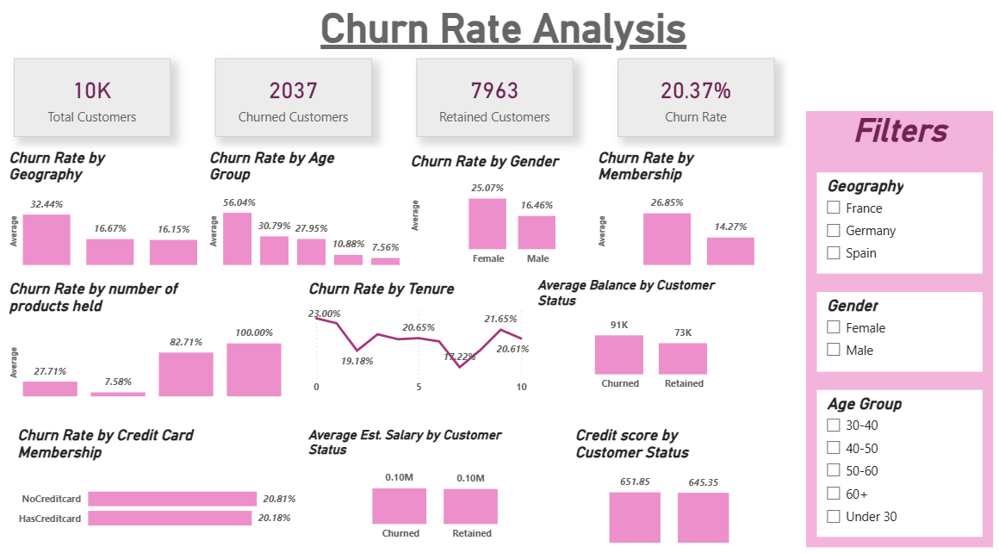

# Bank Customer Churn Analysis

## Project Overview
This project analyzes customer churn in a bank to identify customer segments associated with higher churn rates and understand patterns that may help improve customer retention.

The analysis was performed using Python, SQL Server, and Power BI.

## Business Problem
Customer churn can negatively impact a bank's revenue and customer relationships. The objective of this project is to analyze customer data, identify patterns among customers who leave the bank, and provide insights to support retention strategies.

## Project Objectives
- Analyze overall customer churn.
- Identify customer segments with higher churn rates.
- Explore churn patterns across age, geography, gender, activity, and number of products.
- Provide data-driven business recommendations.

## Dataset
- Total records: 10,000 customers
- Total columns: 14
- Target variable: `Exited`
  - 0 = Retained
  - 1 = Churned

The dataset includes customer attributes such as age, geography, gender, credit score, tenure, account balance, number of products, activity status, and estimated salary.

## Tools Used
- Python (Pandas)
- SQL Server (SSMS)
- Power BI
- Microsoft PowerPoint

## Key Findings
- Overall customer churn rate: 20.37%.
- Germany had the highest churn rate at 32.44%.
- Customers aged 50–59 had the highest churn rate at 56.04%.
- Female customers had a higher churn rate than male customers.
- Inactive customers had a higher churn rate than active customers.
- Customers with 3 or 4 products showed exceptionally high churn rates.

## Business Recommendations
- Investigate customer churn in Germany.
- Develop engagement campaigns for inactive customers.
- Explore retention strategies for higher-risk age groups.
- Investigate why customers with 3 or 4 products have high churn rates.
- Prioritize personalized retention support for high-balance customers.

## Power BI Dashboard

## Project Files
- `bankchurn.py` – Python analysis
- `bank_churn_analysis.sql` – SQL queries
- `bank_churn_analysis_powerbi.pbix` – Power BI dashboard
- `Bank Customer Churn Analysis.pptx` – Project presentation
- `powerbiscreenshot.png` – Dashboard screenshot

## Conclusion
This analysis highlights customer segments and characteristics associated with higher churn. These insights can help a bank prioritize customer retention initiatives and further investigate the factors influencing customer decisions.

*The findings represent associations in the dataset and do not establish causation.*

